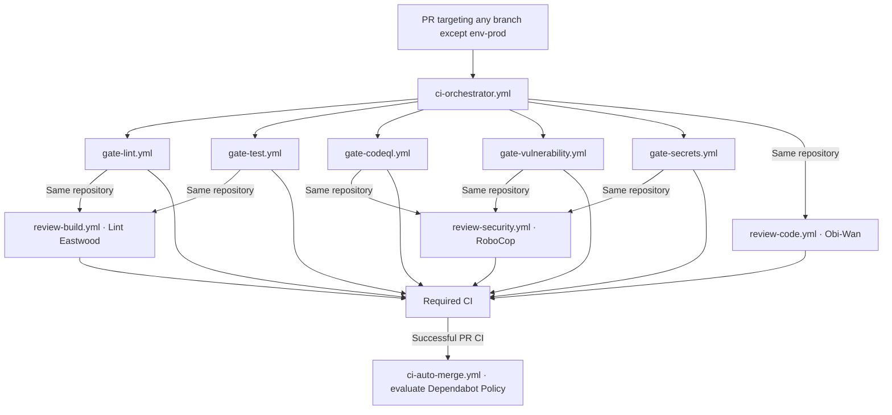
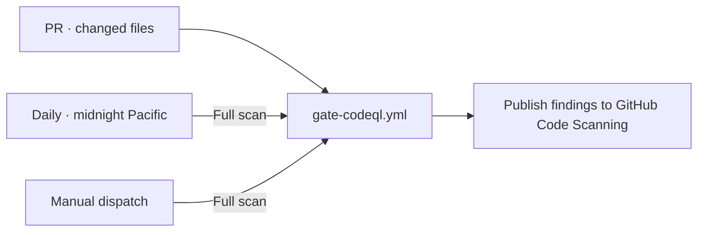
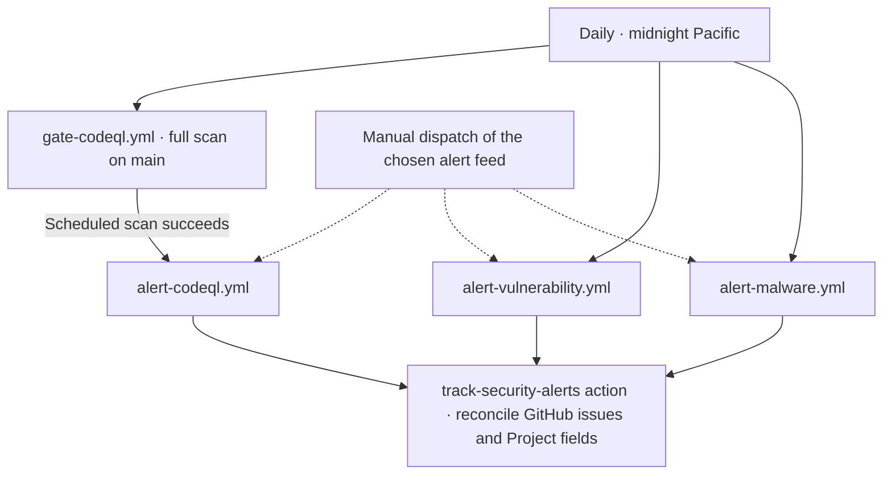
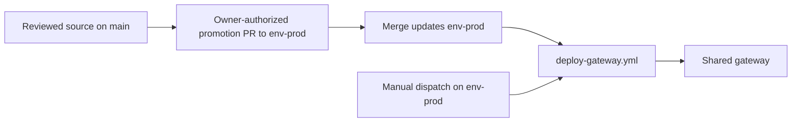

# 🔄 GitHub workflows

Start with [ci-orchestrator.yml](ci-orchestrator.yml) for a pull request. The other entry points are the daily CodeQL scan, the alert trackers, the Dependabot follow-up and the gateway deployment.

## 🧭 Structure

| File | When it runs | What to look for |
| --- | --- | --- |
| [ci-orchestrator.yml](ci-orchestrator.yml) | PR opened, updated, reopened or marked ready against any branch except `env-prod` | Starts the independent gates and the eligible reviewers. A newer run for the PR supersedes the previous run. |
| [gate-lint.yml](gate-lint.yml) | Called by PR CI | Lints workflow YAML and shell, checks JavaScript syntax and compiles the Infrastructure Python programs. |
| [gate-test.yml](gate-test.yml) | Called by PR CI | Selects gateway, shared release and automation checks by changed files. Reports which ran and their results. |
| [gate-codeql.yml](gate-codeql.yml) | Called by PR CI, daily at midnight Pacific, or manually | Scans the selected Python, JavaScript/TypeScript and Actions configurations on PRs. Scheduled and manual runs select all three. |
| [gate-vulnerability.yml](gate-vulnerability.yml) | Called by PR CI | GitHub Dependency Review checks dependency changes and fails on high or critical advisories. Its native check has the findings. RoboCop gets a bounded 16 KiB summary. |
| [gate-secrets.yml](gate-secrets.yml) | Called by PR CI | Gitleaks checks the PR for exposed credentials using a checkout with full history. The result is an independent check. |
| [review-code.yml](review-code.yml) | Same-repository PR, including Dependabot | Obi-Wan reviews the source diff and prior discussion. A major Dependabot update also needs a complete upstream evidence brief. |
| [review-build.yml](review-build.yml) | Same-repository PR, after lint and tests finish | Lint Eastwood reviews build and test results with their bounded diagnostics, including failures. |
| [review-security.yml](review-security.yml) | Same-repository PR, after the security gates finish | RoboCop reviews dependency and secret findings, CodeQL scope, analyzer results and default-branch baselines. |
| [ci-auto-merge.yml](ci-auto-merge.yml) | Successful PR CI completes | Code from `main` validates the exact PR head, records Dependabot Policy and may enable native auto-merge for an eligible dependency update. |
| [alert-vulnerability.yml](alert-vulnerability.yml) | Daily at midnight Pacific or manually | Reconciles open Dependabot vulnerability alerts with Project tracking issues. |
| [alert-malware.yml](alert-malware.yml) | Daily at midnight Pacific or manually | Classifies advisories referenced by this repo’s open Dependabot alerts and tracks malware findings. |
| [alert-codeql.yml](alert-codeql.yml) | After a successful scheduled CodeQL scan on `main`, or manually | Reads the published Code Scanning alerts and reconciles their tracking issues. |
| [deploy-gateway.yml](deploy-gateway.yml) | Push to `env-prod` or manual dispatch on that branch | Deploys the authorized shared gateway. The owner and source checks run before SSH credentials are loaded. |

## Reading and changing the automation

- **Workflow YAML** declares triggers, permissions, jobs, conditions and short step commands. Keep standalone JavaScript programs in [scripts](../scripts) with lower-case, hyphenated names starting with a verb. Use `setup` for actions that configure the runner, `get` to fetch data, `write` for files and workflow outputs, and `evaluate` for interpreting results. Keep visible credential boundaries in the calling step.
- **Reusable steps** live in [actions](../actions/README.md). Each action has one directory, an `action.yml` interface and any implementation files beside it.
- **Tests** live in [.github/tests](../tests). The automation runner discovers top-level suites. Group each script or action’s tests in `<implementation-name>.test.js`. Tests for logic defined directly in workflow YAML take the workflow’s name. A test may exercise other components through its primary entry point. [Fixtures](../fixtures) holds sample inputs and expected outputs. The gateway check in `integration/` is called explicitly with its Docker prerequisites.
- **Enforcement** runs in the PR test gate when GitHub automation changes. [validate-workflows.js](../scripts/validate-workflows.js) checks layout, local action reachability, workflow script references, pins and explicit permissions. Proposed write permissions are compared with the same workflow and job in the trusted base commit. The gateway workflow delegates host operations to Infrastructure’s gateway transport.

### Main branch required checks

`Required CI` waits for every independent gate and all three applicable reviews. It checks for failed, cancelled or unexpectedly skipped jobs. A failed path detector cannot excuse a skipped suite. Fork PRs run the independent gates without reviewer credentials. Applicable same-repository reviewers need a usable current-head verdict.

### Protected Dependabot auto-merge

The policy uses the changed paths returned by GitHub. An empty list selects no file-specific checks. Fetch errors propagate, and the policy still requires the independent gates and current-head reviewer approvals.

The follow-up resolves the successful CI run to its open PR into `main`. It reads reviewed code from `main`, the proposed commit as data, the required status checks and the three reviewers’ current-head approvals. Signed patch/minor metadata can qualify for native auto-merge with `expectedHeadOid`. Major updates and SHA-only Action changes without a verified update type need owner review. An open alert on an updated package blocks automatic eligibility if its CVSS score exceeds 6.9 or is missing or invalid. Production promotion has separate owner authorization. [Repository configuration](../README.md)

### Security-alert configuration contract

The daily schedules use `America/Los_Angeles` and follow daylight-saving time. Each feed also accepts manual dispatch. The three callers resolve the `AI_REVIEW_*` variables and pass them into the shared action. RoboCop’s App token reads that feed and writes its issues. The personal Project token supplies Project access. The action validates credentials and field schema before reading alerts or updating issues.

A grouped ticket records each source alert once. High alerts raise a group to P1 and critical alerts to P0. Unknown severity also warrants P1. Existing higher priorities and other planning fields are preserved. If synchronization fails partway, rerun the same feed. The action reads the saved issue and Project state before retrying and confirms closure before reporting success. [Alert implementation](../actions/track-security-alerts/action.yml) · [Project setup and credentials](../README.md)

## 🗺️ Architecture and trust boundaries

### Pull request



### CodeQL analysis



### Daily alert tracking



### Production deployment



[Gateway operation](../../nginx/README.md) · [Shared application release source](../../app-release/README.md)

## 🧪 Checks and diagnostics

The automation lint and test jobs read their Node version from `.github/package.json`. Run from the repository root with Git, Bash, Node and the locked Python environment. The lint workflow installs the pinned Actionlint release and verifies its checksum.

```sh
npm ci --prefix .github --ignore-scripts --no-audit --no-fund
node .github/scripts/run-automation-tests.js
node .github/scripts/validate-workflows.js --audit
node .github/scripts/validate-workflows.js --check-codeql-pins
docker compose -f compose.yml config --quiet
uv run --locked python app-release/update_release_manifest.py --check
actionlint -ignore 'unknown permission scope "vulnerability-alerts"'
```

The ingress check additionally needs Docker, isolated networks, OpenSSL and the gateway’s fixture images. Shared release changes run the canonical tests against a pinned disposable consumer. Use a disposable local or CI daemon for both. The automation runner discovers top-level JavaScript tests and returns Node’s test exit code. Gate jobs keep the command’s exit status when writing bounded diagnostics for Lint Eastwood.

## 🧪 Coverage boundaries

CodeQL queries the configured languages. Dependency Review and malware advisories cover known published findings. Infrastructure has a uv lockfile, an npm lockfile for GitHub automation, and an alert-malware tracker. Its PR pipeline has no frontend npm lockfile scanner. Gitleaks checks for potential credentials. Local tests use synthetic responses and disposable data. GitHub runner permissions, credential access and production health require separate live evidence.
