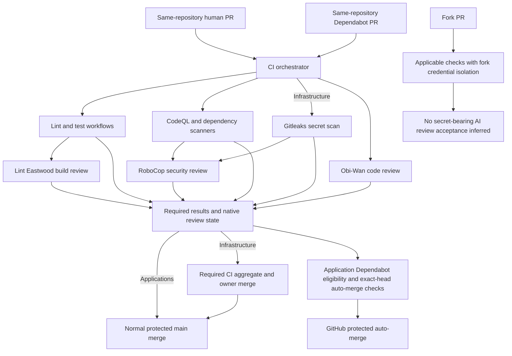
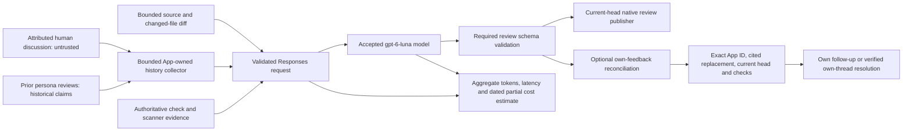
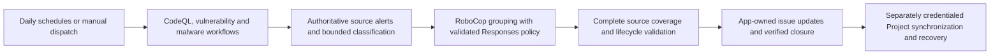
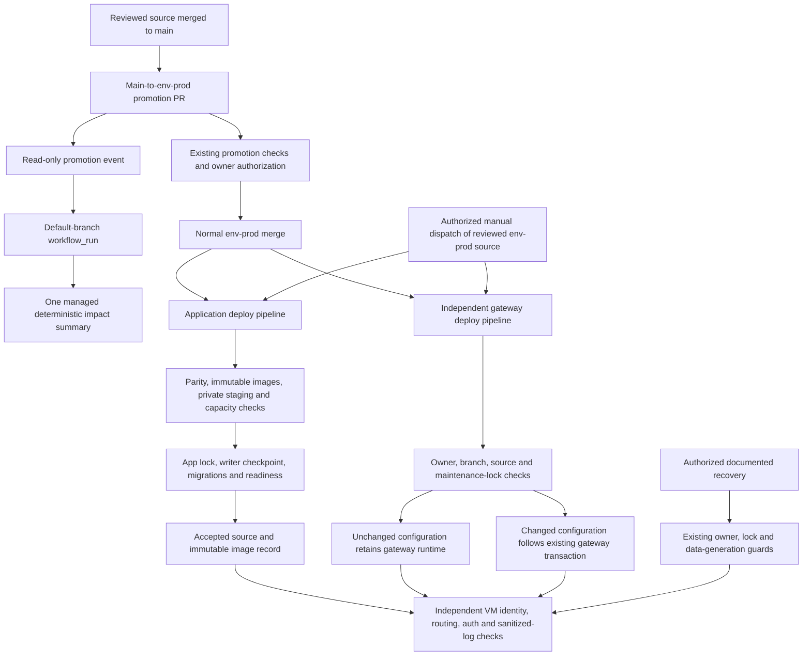

# 🔄 GitHub workflows

CI, reviews, dependency/security checks, and release behavior for JudeAndrewAlabaInfrastructure.

## 🧭 Workflow map

| Area | Entry points |
| --- | --- |
| Pull requests | [CI orchestrator](ci-orchestrator.yml), independent gates, and the three reviewer workflows. |
| Security alerts | [CodeQL](alert-codeql.yml), [vulnerability](alert-vulnerability.yml), and [malware](alert-malware.yml) schedules/manual dispatches. |
| Promotion evidence | [Read-only request](promotion-summary-request.yml) and [trusted summary](promotion-summary.yml). |
| Releases | [Release workflow](deploy-gateway.yml). |

Workflow YAML is authoritative for triggers, permissions and job dependencies.
Read [repository setup](../README.md) before expecting secret-dependent workflows
to succeed. Commands in this guide run from the repository root.

## 🔄 Pull requests and reviews

A new CI run for a pull request cancels the older run for that pull request.
The current run follows the job dependencies in the workflow.

### Major-upgrade review evidence

Obi-Wan uses Dependabot's per-dependency metadata for grouped upgrades.
Release lookups use each major update's own ecosystem and target version.
Repository usage searches cover every listed dependency and retain the
tracked-file exclusions and 30,000-byte limit. Numeric Actions references
such as 7 and v7 can match a full release tag such as v7.0.0. Opaque refs
leave a visible evidence gap. Required briefs need at least one valid HTTP(S)
source URL. The publisher keeps independent body findings when it suppresses
duplicate inline comments or sees an unchanged verdict.

<a id="-ai-reviewer-parity-across-repositories"></a>

### AI reviewer parity across repositories

The common contract is all three reviewers on trusted same-repository human
and Dependabot PRs, no secret-dependent reviews on forks, separate per-persona
OpenAI keys within each repository, six reviewer secrets in each secret store,
and visible failure for unavailable reviews. Infrastructure's implementation
now adopts this eligibility contract; live acceptance still requires real
Dependabot credentials and a Dependabot-triggered run after owner merge.

| Repository | Human / Dependabot AI reviews | Reviewer secret stores | Intentional merge-policy difference |
| --- | --- | --- | --- |
| MacroMapper | All three / all three | Actions + Dependabot | Existing eligible dependency auto-merge and app-specific required checks |
| Notoli | All three / all three | Actions + Dependabot | Existing eligible dependency auto-merge; reviewer branch-policy work is separate |
| FullStackTemplate | All three / all three | Actions + Dependabot | Existing eligible dependency auto-merge and required reviewer child checks |
| Infrastructure | All three / all three | Actions + Dependabot | Owner merge only; Required CI includes every applicable review |

Independent checks, evidence limits and major-upgrade gaps remain specific to
each repository's actual scanners and dependency ecosystems. Infrastructure
retains its non-mutating lint reviewer, immutable actions, no auto-merge,
repository-scoped App tokens and production credential boundary. Parity of
review eligibility does not copy application deployment or auto-fix behavior.

After owner-approved merge, update or rerun a real same-repository Dependabot PR
using the new default-branch policy; an old run retains its original workflow
revision. Verify the run actually uses the new policy, all three App identities,
required review outcomes, and supported major-upgrade evidence or documented
gaps. A human PR run does not prove access to the Dependabot secret store.

<a id="-workflow-supply-chain-controls"></a>

### Workflow supply-chain controls

The workflow security checker and mocked regressions reject mutable external
Action references, missing version comments, broad permission grants and privileged
PR-target triggers. Run `node .github/actions/check-workflow-security/check-workflow-security.js`
and its `*.test.js` suite locally. Repository defaults were independently audited
as read-only with workflow-token PR approvals disabled. GitHub App reviewers keep
their separate credentials and explicit grants. SHA enforcement is enabled only
after source compliance and required final-head validation.

Repository Actions secrets are not branch-scoped: writers able to install arbitrary
workflows remain privileged. This helper validates checked-in policy but cannot
constrain a workflow that bypasses it. GitHub rulesets and independent review
remain necessary. The checker parses YAML nodes, including quoted/flow/sequence
forms, rejects aliases, duplicate and merge keys, and requires pinned PyYAML 6.0.3.

Declare permissions explicitly in the workflow or job. The checker rejects broad
grants such as `write-all` and unknown permission scopes or levels. Review changes
to write permissions in the pull request that changes the workflow.

## 🔒 Merge and dependency controls

<a id="-required-checks-and-permissions"></a>

### Required checks and permissions

`Required CI` in the CI workflow requires independent gates and all applicable reviews.
Failed/cancelled/unexpectedly skipped checks block it. REQUEST_CHANGES,
unavailable AI output and diff overflow fail reviewer checks. Inline placement,
prior-history and duplicate suppression are tested. Bot approval never
authorizes merging or deployment.

Same-repository human and Dependabot PRs require all three AI reviewers as
well as every independent gate. Fork PRs run the independent read-only gates
without receiving reviewer secrets. There is no `pull_request_target` workflow.
Dependabot uses its separate secret store for all six reviewer credentials;
missing credentials or skipped applicable reviews fail Required CI. Obi-Wan's
existing metadata/major-upgrade evidence path applies to Dependabot updates,
with web search enabled only for major upgrades and explicit gaps for unsupported
evidence. Dependabot still requires manual owner merge; AI review adds no merge
or deployment authority.

GITHUB_TOKEN begins with contents read. Only CodeQL upload/review jobs request
additional permissions. App tokens name this repository and explicit permissions;
Lint Eastwood receives contents read despite its existing broader account
installation. Checkout does not persist credentials. Review/scanner workflows
never request contents write, commit fixes, merge or deploy. The separately
approved gateway workflow below uses isolated production credentials.

Alerts serialize each feed, validate every source ref exactly once, and manage
only `infrastructure-security-alert` issues. Missing credentials, unavailable
feeds, malformed AI JSON or absent Project metadata fail visibly. Source links
remain; secret and private host/recovery contents are excluded.

## 🛡️ Security and alerts

### Infrastructure checks

| Capability | Behavior |
| --- | --- |
| Obi-Wan Code-nobi | Infrastructure correctness, maintainability, valid inline comments and prior-review history |
| Lint Eastwood | Interprets actionlint/ShellCheck, Compose, ingress/reversal, SQLite recovery and automation diagnostics; never edits source |
| RoboCop | Interprets authoritative scanner evidence and infrastructure security risks |
| CodeQL | All present Python, automation JavaScript and Actions sources on every PR, main push and weekly/manual runs |
| Dependency Review | New high/critical vulnerable dependencies block PRs; Actions use GitHub's dependency graph |
| Package malware | Explicitly inapplicable without manifests; adding a manifest blocks until scanner support is reviewed |
| Secrets | Gitleaks on PRs plus repository secret scanning and push protection |
| Dependabot | Weekly grouped Actions and separate Compose updates, limits, owner assignment and existing labels |
| Security alerts | Daily/manual CodeQL, all-severity vulnerabilities and advisory-classified malware, RoboCop issues and Project #13 metadata |

CodeQL/Dependency Review do not scan Nginx configuration or image contents for
malware/CVEs. Disposable Nginx tests cover actual routing, DNS, forwarding/trust,
logging and reversal. Image updates require separate operator-reviewed
image/advisory assessment and production authorization.

<a id="-dependency-evidence-and-alert-lifecycle-parity"></a>

### Dependency evidence and alert lifecycle parity

The reusable baseline is FullStackTemplate's `.github/actions/prepare-vulnerability-report`.
MacroMapper, Notoli and Infrastructure carry the same report implementation and
regression contract. Dependency Review still blocks high/critical additions;
every non-success scanner outcome, missing/malformed output or failed evidence
preparation fails the independent Vulnerability check. No empty-array fallback
may turn unavailable evidence into a clean scan. RoboCop receives at most 16 KiB
of package/severity/manifest context, with omitted-entry counts. The
`dependency-review-evidence` artifact retains every structured entry for seven
days, excluding untrusted free text and arbitrary URLs; unavailable evidence is
retained as structured diagnostics. Artifacts have the repository's Actions
access controls, not an additional private storage boundary.

Alert synchronization saves source history/replacement links first, ensures
Project membership, then writes End date before Status Done. Done can trigger
Project auto-close. The issue client re-reads state before a separate state-only
close. Only GitHub's observed HTTP 422 `Validation Failed` with an empty errors
array is eligible for recovery, and only if another read proves closed/completed
with the exact saved lifecycle body. Other failures propagate. Partial Project
failures leave the issue open for rerun; issue mutations remain attributed to
RoboCop and Project writes use the separate Project credential. New items use
the live `Work type` field. No credentials, branch protections or deployments
change.

Historical evidence: FullStackTemplate #192 closed at 2026-10-11 16:40:51 UTC,
before run 38156425534's state-close PATCH returned 422 at 16:40:52 UTC with
`errors: []`. Notoli #825 has the same earlier pattern. All four Projects have
Auto-close issue enabled (read-only verification 2026-10-20). This establishes
the competing-close ordering; GitHub's internal validation cause is not exposed.
Mocks reproduce that interleaving and reject unrelated errors. Empty scheduled
feeds do not establish that a live close race occurred.

Infrastructure deliberately retains weekly grouped Actions and separate Compose
Dependabot updates, all-language CodeQL on every run, `pull-requests: read` for
Dependency Review, immutable actions and the separate secret-scanning gate.
Dependency graph evidence covers supported Actions/Compose dependencies; it is
not an image-content scanner and does not assume backend/frontend directories.

<a id="-compatible-codeql-updates"></a>

### Compatible CodeQL updates

The current CodeQL entry points use the same immutable v4.39.3 revision.

Dependabot groups all `github/codeql-action` entry points (including `init`,
`analyze`, `autobuild` and `upload-sarif`) in `codeql` version-update PRs.
A separate `codeql-security` group applies the same matching to security updates;
GitHub does not combine version and security updates in one group. Keep both
patterns (`github/codeql-action` and `github/codeql-action/*`) so repository and
entry-point dependency names match. Review every CodeQL entry point together,
keep their immutable revisions aligned, and preserve normal CI/reviewer gates.

The applications retain daily updates. Infrastructure retains weekly updates,
its owner/labels/PR limits, general Actions group for non-CodeQL updates, and
separate Compose updates. The template aligns its mutable CodeQL tag with the other repositories'
immutable v4.39.1 revision. Scanner scope, permissions and merge/deployment
gates remain unchanged. Canonical rollout:
[FullStackTemplate #271](https://github.com/VanillaIceCube/FullStackTemplate/issues/271).

<a id="-atomic-codeql-regression-guard"></a>

### Atomic CodeQL regression guard

FullStackTemplate is the canonical application Dependabot policy (#240).
Infrastructure adopts the common CodeQL revision guard and negative tests before
its required scope detection: every CodeQL entry point in `.github` must use
the same full immutable SHA. Split init/analyze, cross-workflow drift, mutable
tags and missing analysis fail visibly. The version/security update groups
merged in #106 remain unchanged, including weekly cadence and separate Compose
updates. Run `node --test .github/actions/check-codeql-pins/*.test.js` locally.

Application auto-merge is intentionally inapplicable here: retain owner merge,
independent Required CI, all three same-repository Dependabot reviewers, no fork
secrets, and separate production/recovery authorization. Successful Dependabot
review evidence already exists on #53 and #33; human implementation PRs alone
do not prove Dependabot secret access. No shared app-release behavior changes.

The CodeQL guard parses YAML structurally with `PyYAML==6.0.3` (safe loading),
including flow mappings, quoted/escaped keys, folded values and aliases. Install
the locked parser for local Node regressions: `uv sync --locked`, followed by
`uv run --locked node --test <test files>`.

### Security-alert recovery

Each feed serializes scheduled and manual reconciliation. Before issue writes,
source coverage must be complete and unique. A valid model draft that omits refs
gets deterministic source-linked work items and an explicit warning; malformed
JSON, invalid schemas, unknown refs and duplicate memberships fail before writes.
Existing managed source refs select the canonical issue even when wording changes.

Project attachment retries transient failures at most three times, reading back
possibly committed writes before retrying. Unresolved attachments identify the
saved issue; rerun the same feed to reuse it. Interrupted field initialization fills
only missing fields, preserving human planning. All active groups synchronize before
superseded issues can close. Closure saves source history and End date before Done.
Only the observed empty-error or exact Issue/custom concurrent-close HTTP 422 may
recover, and only after readback proves closed/completed with the exact saved body.
All other errors remain failures. A successful empty feed does not exercise the race.

Infrastructure retains weekly Dependabot cadence, Required CI, and owner merge; application auto-merge is not adopted.

Malware lookup retains per-source-GHSA requests and rejects mismatched or unknown advisory classifications before writing the source checkpoint or changing issues. Empty feeds make no advisory requests.

### Security-alert configuration contract

The three `alert-codeql.yml`, `alert-vulnerability.yml`, and `alert-malware.yml`
workflows resolve `AI_REVIEW_MODEL`, `AI_REVIEW_REASONING_EFFORT`, and
`AI_REVIEW_MAX_OUTPUT_TOKENS` in their supported workflow `vars` context. They
pass explicit `model`, `reasoning-effort`, and `max-output-tokens` inputs to the
security-alert composite. Do not reference repository `vars` inside composite
manifests: GitHub rejects that metadata before alert fetching starts (#300).

Absent or empty values deliberately preserve `gpt-6-luna`, `medium`, and `16000`.
Nonempty overrides pass through the existing Responses policy. Configuration is
validated before source reads or issue/Project writes, including empty feeds;
invalid models, efforts or token limits fail visibly without a provider call.
No model migration, credential/project consolidation, retry or spending policy
change is implied. Infrastructure retains its additional Project-schema preflight,
all-severity vulnerability feed and distinct token/Project permissions.

`node --test .github/actions/custom-regressions/security-alert-contract.test.js`
checks actual YAML inputs/callers, audits local composites for unsupported `vars`,
and executes manifest-derived configuration, fetching, nested Responses shell,
validation and reconciliation code using synthetic feeds and mocked provider/API
writes. Existing lifecycle tests still cover complete accounting, partial-progress
recovery and the exact concurrent-close HTTP 422 case. These fixtures are not a
GitHub runner. After a reviewed repair, run one fresh controlled dispatch of each
alert workflow from corrected `main`, after checking managed labels/Project side
effects. Record runner loading/empty-feed evidence separately from nonempty mock
coverage; never rerun an old failed revision as proof of the new source.

## 🚀 Releases and promotion

Infrastructure owns the independent shared gateway and release-engine source.
Use [gateway releases and recovery](../../nginx/README.md#-operations) and the
[application release standard](../../app-release/README.md) for current
owner/source/branch controls. Application source or CI approval does not authorize
host operations. Preserve immutable accepted state, locks and explicit recovery.

<a id="-gateway-release-workflow"></a>

### Gateway release workflow

`deploy-gateway.yml` handles only separately authorized `env-prod` promotions
and explicit manual retries/rollback on that branch. It is disabled until the
repository enable variable, reviewed source/workflow and owner/branch validation
and private host adoption prerequisites are established. It uses separate
production credentials, persistent host transactions, exclusive maintenance
locking and gateway-only recovery. Review/scanner workflows cannot deploy.
Like the Notoli and MacroMapper deployment workflows, an authorized promotion
to `env-prod` starts deployment without a second reviewer or per-release
approval variable. Source PRs still require the normal main-branch checks.
See [gateway releases](../../nginx/README.md#-operations) for setup, bounded probes,
relevant-change policy, Actions evidence, interruptions and retention. Gateway SSH
configuration lives only in repository Actions settings; no GitHub Environment
or Deployment API record is required. Repository-wide key exposure and the
reviewed-workflow/write-access boundary are documented in that guide.

### Architecture and production summaries

The [canonical architecture reference](README.md#-architecture-and-trust-boundaries) maps PR/fork/
Dependabot paths, required checks, reviewer interactions, scheduled alerts,
main-to-env-prod/manual release paths and credential trust boundaries to source.
Its per-repository source inventory is checked against actual workflow YAML.

`promotion-summary-request.yml` is a read-only PR/target-push signal with no checkout or
artifact/cache handoff. Its default-branch `workflow_run` consumer
`promotion-summary.yml` maintains one GitHub Actions-owned comment for each open
same-repository `env-prod` PR using the actual current target comparison. Reruns
update the same comment; stale/incomplete/denied evidence is reported visibly.
Observed area counts are separate from inferred risks. The workflow loads trusted
main code, never PR code/prose or secret values, and does not change review,
merge, release or recovery authorization. Infrastructure uses gateway-specific
wording. FullStackTemplate's inactive target is not created for symmetry.

## 🧪 Checks and diagnostics

<a id="-validation-and-activation"></a>

### Validation and activation

```sh
docker compose -f compose.yml config --quiet
uv run --locked python app-release/update_release_manifest.py --check
uv run --locked node --test .github/actions/*/*.test.js
bash .github/tools/install_actionlint.sh
PATH="${RUNNER_TEMP:-/tmp}/infrastructure-tools:$PATH" bash .github/tools/lint_infrastructure.sh
```

Use Node 24, uv with the locked Python 3.12 project, Docker, OpenSSL and ShellCheck. The Linux amd64
actionlint installer verifies its pinned checksum. CI captures bounded diagnostics
while enforcing original exit status. Shared release changes require a regenerated manifest and matched consumer pins.

CI report files are decoded as UTF-8 with replacement for malformed bytes. Gateway
evidence always goes to stdout; it also appends UTF-8 text when a nonempty
`GITHUB_STEP_SUMMARY` path is configured. Only validated identities and fixed prose
belong in this evidence; never include credentials or private recovery output.

See [setup](../README.md#-before-your-first-pull-request). Default-branch Dependabot/schedules activate after
owner merge. The unmerged feature PR proves checks and identities, not scheduled
activation. No merge, promotion or production operation is implied.

Infrastructure validation checks Compose configuration, the canonical shared
release manifest and action-local Node regressions, including architecture
dependency/privilege contracts. Compose and action-test failures still fail the
validation job. The root ingress, gateway transaction/retirement, snapshot,
release-profile matrix, automation-policy and bounded-log suites were retired.
Reusable ingress/recovery outputs remain available to the build reviewer as
`not-applicable`, with explicit retired-suite descriptions; no runtime routing or
recovery acceptance is claimed. Canonical `app-release/v1/tests/` and consumer
deployment suites remain separate and unchanged.

<a id="-automation-regressions-and-bounded-diagnostics"></a>

### Automation regressions and bounded diagnostics

See [the shared inventory](README.md#-coverage-boundaries). Actual composite
request construction and prior-review collection run with mocked curl/GitHub reads,
not live paid API calls. Diagnostic preprocessing remains active, bounding context
to 16,000 characters and artifacts to about 1 MiB per log for seven days; its root
regression test has been retired. Complete output remains in the job log.
Preprocessing feeds the existing `ci_report.py` interface.

The shared YAML regression suite checks aliases, flow syntax, and explicit
permission mappings.
Repository writers remain privileged; this linter is not a security sandbox.
Infrastructure retains its existing shellcheck, Compose, secret scan, manifest,
RequiredCI and independent gateway controls. Application browser tests and npm
malware gates are not applicable here.

<a id="-locally-runnable-reporting-helpers"></a>

### Locally runnable reporting helpers

Guard runner-only output/summary variables. CI reports must preserve identical
framing and bounded evidence through output-file and unset-variable stdout
modes, using unpredictable delimiters. Test missing logs, malformed UTF-8 and
absent/empty/configured summary paths with disposable fixtures; preserve the
snapshot cleanup and primary-error behavior covered by the existing tests.

Validate syntax and relevant behavioral tests after automation changes. Preserve
original check failures and bounded/redacted diagnostics. Use disposable fixtures
for validation.

<a id="-related-guides"></a>

## 📚 Reference

- [Repository setup and credentials](../README.md).
- [Local actions and reviewer contract](../actions/README.md).
- [CI/CD architecture and trust boundaries](README.md#-architecture-and-trust-boundaries).

## 🗺️ Architecture and trust boundaries

Workflow YAML and protected-branch rules remain authoritative. FullStackTemplate
owns reusable application/reviewer patterns; Infrastructure owns the gateway and
versioned application release engine. Intentional app and Infrastructure policies
remain distinct.

### PR paths and required evidence



[The orchestrator](ci-orchestrator.yml) excludes application `env-prod` PRs;
Infrastructure restricts it to `main`. Same-repository human and Dependabot PRs
receive the configured reviewers. Forks receive no reviewer credentials: never
execute fork code with privileged credentials or add `pull_request_target` here.
Obi-Wan starts independently; Lint Eastwood consumes lint/test outcomes; RoboCop
consumes scanner evidence, including Infrastructure's secret scan. Missing evidence,
credentials, invalid output and `REQUEST_CHANGES` fail. Skipped or old-head reviews
are not current-head acceptance. App Dependabot auto-merge verifies the exact head
without executing PR code; Infrastructure retains Required CI and owner merge.

### Reviewer data and write boundary



The [action contract](../actions/README.md) owns byte/page/count limits, identity,
serialized writers and reconciliation proof. Discussion and tool output are
untrusted data: they cannot authorize commands, secret disclosure, merges or
suppressed findings. Unavailable/truncated context is disclosed. Only provably
replaced, own-App feedback may be reconciled; human/other-bot threads remain open.
Reconciliation never dismisses a blocking verdict or changes required checks.
Each repository/persona retains separate credentials and the accepted Luna model.
Usage/cost estimates are partial and dated; unknown charges remain unknown.
Web search stays limited to Dependabot major-upgrade code reviews.

[Repository setup](../README.md) owns exact secret/variable names and installation
permissions. Dependabot receives required reviewer OpenAI keys/App private keys,
never production/Project credentials. RoboCop owns security-alert issue writes;
the separate Project token only synchronizes Project fields. Repository Actions
secrets are not branch-scoped: arbitrary workflow writers remain privileged.
External Actions use immutable pins. Workflow reviews cover changes to write
permissions in the workflow or job that requests them.

### Scheduled source-alert maintenance



[CodeQL](alert-codeql.yml), [vulnerability](alert-vulnerability.yml) and
[malware](alert-malware.yml) aggregation run daily or by dispatch. Incomplete
source/model evidence fails before lifecycle writes; verified closure and Project
recovery preserve their independent credential boundaries. CodeQL analysis also
runs on applicable main pushes, scoped PRs and manual dispatch. Alert maintenance
neither merges code nor deploys.

### Promotion, release and manual operations



The [read-only listener](promotion-summary-request.yml) emits a fixed signal with
no checkout, artifacts/caches, secrets or write token. The [trusted consumer](promotion-summary.yml)
uses reviewed main code, independently fetches current metadata, excludes fork
producers and serializes one managed bot comment per open same-repository promotion
PR (up to ten). It trusts neither producer conclusions nor supplied PR identities.
Incomplete inventories, moving revisions or uncertain writes remain visible;
summary failures do not mask required CI or authorize a release.

Promote exact reviewed main source through existing `env-prod` controls. Keep
independent app/gateway transactions, immutable digests, private recovery sets,
locks and explicit data-generation barriers. Compare the entire promotion diff
and independently verify running identity, routes, auth and sanitized logs.
Readiness is not authenticated/mail acceptance. Never restore older SQLite data
over newer committed writes or assume migrations can be reversed. App releases
never recreate shared ingress/networks or prune the host. Docs/workflow-only changes
need no unnecessary restart. FullStackTemplate has no active production target;
its onboarding examples do not authorize new resources or an `env-prod` branch.

### Maintaining the architecture

When editing a workflow, review its triggers, job dependencies, permissions,
and trust boundaries. Update the diagrams when those relationships change.

## 🧪 Coverage boundaries

Action-local regressions cover reviewer publishing, security-alert lifecycle,
dependency evidence and workflow permission and pin policy under their existing
gates. App repositories retain backend, frontend/browser and shared
release suites; the canonical release tests remain in Infrastructure `app-release/v1`.
Root tooling, gateway/ingress, SQLite snapshot and release-profile suites were
removed at the owner's request. Their former coverage is not provided by the
remaining checks. Mocked/local evidence does not establish live reviewer loading,
authenticated production journeys, recovery acceptance, physical-device behavior,
email receipt or paid AI behavior. Use disposable fixtures and separately authorized
runtime verification for those claims.

### Locked repository Python tooling

The root `pyproject.toml` declares a non-packaged Python 3.12 tooling project;
`uv.lock` records the complete PyYAML graph. Run `uv sync --locked` and use
`uv run --locked` for local checks. The local `setup-uv` action bootstraps uv
0.13.8, synchronizes the same lockfile and exposes its Python to Node subprocesses.
Dependabot uses the `uv` ecosystem at `/` with the existing weekly cadence.
Production hosts still run ordinary Python release/gateway scripts and do not
need uv or this developer environment.

The dependency-scope gate permits only this root PyYAML tooling project and
rejects additional manifests, runtime dependencies or an expanded lock graph
until scanner coverage is reviewed. Dependency Review retains known-advisory
coverage; no mandatory Python malware service is configured. A locked graph
provides reproducibility and does not establish package malware safety. Docker
image advisories and live operations keep their separate operator acceptance.

Dependabot's `uv` updater reads `pyproject.toml` and `uv.lock`; a requirements
export is unnecessary. Runtime and development dependencies retain the existing
reviewer and independent-check policy. The source diff keeps `uv.lock` reviewable;
only the separate dependency-usage search omits generated lockfile matches.
The uv executable is a deliberately pinned toolchain bootstrap in `setup-uv`
and application Dockerfiles; package dependency PRs do not change that bootstrap.
Review and synchronize its version and CI wheel hash separately when upgrading
the toolchain; see the [verified bootstrap contract](../actions/README.md#-python-toolchain-bootstrap).
Hosted version/security update acceptance still requires a fresh Dependabot run
after the reviewed configuration reaches main.
