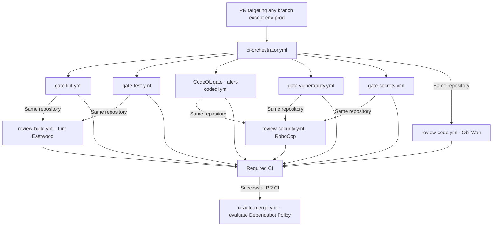
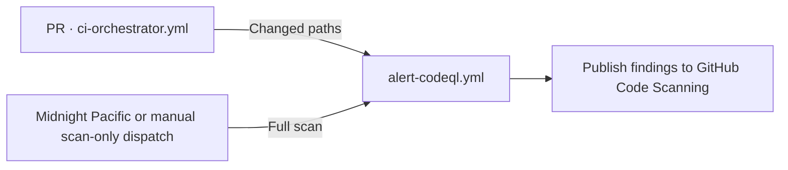
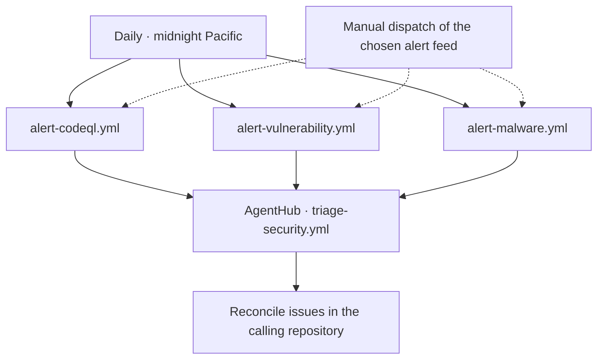
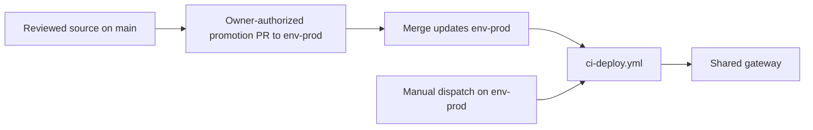

# 🔄 GitHub workflows

Start with [ci-orchestrator.yml](ci-orchestrator.yml) for a pull request. The other entry points are the three alert workflows, the Dependabot follow-up and the gateway deployment.

## 🧭 Structure

| File | When it runs | What to look for |
| --- | --- | --- |
| [ci-orchestrator.yml](ci-orchestrator.yml) | PR opened, updated, reopened or marked ready against any branch except `env-prod` | Starts the independent gates and the eligible reviewers. A newer run for the PR supersedes the previous run. |
| [gate-lint.yml](gate-lint.yml) | Called by PR CI | Lints workflow YAML and shell, checks JavaScript syntax and compiles the Infrastructure Python programs. |
| [gate-test.yml](gate-test.yml) | Called by PR CI | Selects gateway, shared release and automation checks by changed files. Reports which ran and their results. |
| [gate-vulnerability.yml](gate-vulnerability.yml) | Called by PR CI | GitHub Dependency Review checks dependency changes and fails on high or critical advisories. Its native check has the findings. RoboCop gets a bounded 16 KiB summary. |
| [gate-secrets.yml](gate-secrets.yml) | Called by PR CI | Gitleaks checks the PR for exposed credentials using a checkout with full history. The result is an independent check. |
| [review-code.yml](https://github.com/VanillaIceCube/agent-hub/blob/main/.github/workflows/review-code.yml) | Same-repository PR, including Dependabot | Obi-Wan reviews the source diff and prior discussion. A major Dependabot update also needs a complete upstream evidence brief. |
| [review-build.yml](https://github.com/VanillaIceCube/agent-hub/blob/main/.github/workflows/review-build.yml) | Same-repository PR, after lint and tests finish | Lint Eastwood reviews build and test results with their bounded diagnostics, including failures. |
| [review-security.yml](https://github.com/VanillaIceCube/agent-hub/blob/main/.github/workflows/review-security.yml) | Same-repository PR, after the security gates finish | RoboCop reviews dependency and secret findings, CodeQL scope, analyzer results and default-branch baselines. |
| [ci-auto-merge.yml](ci-auto-merge.yml) | Successful PR CI completes | Code from `main` validates the exact PR head, records Dependabot Policy and may enable native auto-merge for an eligible dependency update. |
| [alert-vulnerability.yml](alert-vulnerability.yml) | Daily at midnight Pacific or manually | Reconciles open Dependabot vulnerability alerts with repository issues. |
| [alert-malware.yml](alert-malware.yml) | Daily at midnight Pacific or manually | Classifies advisories referenced by this repo’s open Dependabot alerts and tracks malware findings. |
| [alert-codeql.yml](alert-codeql.yml) | Called by PR CI, scheduled at midnight Pacific or dispatched manually | PRs run the applicable CodeQL analyzers. The schedule runs a full scan and independently updates tickets. Manual dispatch updates tickets by default and offers a scan-only option. |
| [ci-deploy.yml](ci-deploy.yml) | Push to `env-prod` or manual dispatch on that branch | Deploys the authorized shared gateway. The owner and source checks run before SSH credentials are loaded. |

## Shared CI for applications

The applications and Infrastructure call the same lint and test gates. The required `application` input selects the jobs. The three app callers pass `true`, and Infrastructure passes `false`. Forks inherit their repository’s setting. Keep the job IDs and display names in each caller. GitHub builds required check names from both the caller job and the called workflow job. The existing application rules require those names individually. Infrastructure and AgentHub use their own `Required CI` and `Dependabot Policy` checks.

| Caller job | Infrastructure implementation | Result |
| --- | --- | --- |
| Lints | [gate-lint.yml](gate-lint.yml) | Runs frontend and backend lint for changed paths. Returns each status and a bounded log. Auto-fix requires an eligible same-repository branch at the event head. |
| Tests | [gate-test.yml](gate-test.yml) | Runs the caller’s frontend build, tests, Django profiles, repository automation and development image checks. Returns the statuses and logs used by the build reviewer. |
| CodeQL | [alert-codeql.yml](alert-codeql.yml) | Selects Python, JavaScript/TypeScript and Actions analysis. Returns the scope decision and language flags. |
| Vulnerability | [gate-vulnerability.yml](gate-vulnerability.yml) | Runs Dependency Review and returns a bounded report. A failed scanner still fails the gate. |
| Malware | [gate-malware.yml](gate-malware.yml) | Reads npm and Python lockfiles as Git objects at the caller’s base and head. The scanner and its locked parser come from Infrastructure. |
| Secret scan | [gate-secrets.yml](gate-secrets.yml) | Runs Gitleaks against the caller’s history. |
| Branch rules | [gate-branch-rules.yml](gate-branch-rules.yml) | Checks branch rule access and GitHub’s expected-head auto-merge API on same-repository PRs. The app reports the result as its required `Auto Merge` check. |
| Dependabot follow-up | [ci-auto-merge.yml](ci-auto-merge.yml) | Validates a successful CI run, its PR head, independent checks, reviews and branch policy before requesting native auto-merge. The caller owns the `workflow_run` trigger and permissions. |

Inside a shared job, `job.workflow_sha` selects the revision containing its scripts and actions. Jobs that need both checkouts put the calling repository in `subject/`. CodeQL analysis and Gitleaks run on the caller. The application keeps its test suites, trigger policy and secrets. [GitHub workflow identity](https://docs.github.com/en/actions/reference/workflows-and-actions/contexts#example-usage-of-job-context-workflow-identity)

### Migration and rollback

Each application keeps six event workflows. PRs call the shared gates and AgentHub reviewers directly so required check names stay stable. All five repositories keep the same three alert entry points. Each passes its feed to AgentHub’s `triage-security.yml` at midnight Pacific or on manual dispatch. CodeQL Alert also calls the shared scanner. The Dependabot completion workflow calls this repository’s policy. Application deployment is generated from the separate release revision in `deploy/production/app.json`.

Cross-repository calls to Infrastructure and AgentHub use reusable workflows at `@main`. AgentHub also checks out Infrastructure’s validation tools from `main`. Each new run picks up compatible changes merged in the provider. GitHub’s full-SHA policy applies to remote actions, so shared workflows run their own composite actions at the resolved workflow commit. Third-party actions and reusable workflows use full commit SHAs. [GitHub Actions settings](https://docs.github.com/en/repositories/managing-your-repositorys-settings-and-features/enabling-features-for-your-repository/managing-github-actions-settings-for-a-repository#managing-github-actions-permissions-for-your-repository)

The CodeQL migration transferred the retired gate’s upload permission to the analyzer jobs in Infrastructure and the scan job in each caller’s `alert-codeql.yml`. The current workflows retain those job-level grants.

Merge a new reusable workflow in the provider before switching callers to it. Keep the named secrets, job names and trigger policy. Compare candidate checks on the same head with lint pushes and review publication disabled. Verify human and Dependabot PRs, failed scans and stale or missing evidence. Revert shared changes in the provider to roll them back for all callers. [Deterministic CI](https://github.com/VanillaIceCube/infrastructure/issues/193) · [Agent migration](https://github.com/VanillaIceCube/agent-hub/issues/8)

Use the successful runs before the migration as examples of the expected jobs. [Infrastructure](https://github.com/VanillaIceCube/infrastructure/actions/runs/46078973999) · [FullStackTemplate](https://github.com/VanillaIceCube/fullstack-template/actions/runs/46078966798) · [Notoli](https://github.com/VanillaIceCube/notoli/actions/runs/46078980131) · [MacroMapper](https://github.com/VanillaIceCube/macromapper/actions/runs/46078986088) · [AgentHub](https://github.com/VanillaIceCube/agent-hub/actions/runs/46078423045)

## Reading and changing the automation

- **Workflow YAML** declares triggers, permissions, jobs, conditions and short step commands. Keep standalone JavaScript programs in [scripts](../scripts) with lower-case, hyphenated names starting with a verb. Use `setup` for actions that configure the runner, `get` to fetch data, `write` for files and workflow outputs, and `evaluate` for interpreting results. Keep visible credential boundaries in the calling step.
- **Reusable steps** live in [actions](../actions/README.md). Each action has one directory, an `action.yml` interface and any implementation files beside it.
- **Tests** for isolated logic live in [unit](../tests/unit). Tests that exercise workflows, actions, files or commands together live in [integration](../tests/integration). Name each suite after the script, action or workflow it exercises. Keep sample inputs and expected outputs in [fixtures](../tests/fixtures).
- **Enforcement** runs in the PR test gate when GitHub automation changes. [validate-workflows.js](../scripts/validate-workflows.js) checks layout, local action reachability, workflow script references, pins and explicit permissions. Proposed write permissions are compared with the same workflow and job in the trusted base commit. The gateway workflow delegates host operations to Infrastructure’s gateway transport.

### Main branch required checks

`Required CI` waits for every independent gate and all three applicable reviews. It checks for failed, cancelled or unexpectedly skipped jobs. A failed path detector cannot excuse a skipped suite. Fork PRs run the independent gates without reviewer credentials. Applicable same-repository reviewers need a usable current-head verdict.

### Protected Dependabot auto-merge

Give each CodeQL analyzer a literal job name. GitHub can report the unevaluated name expression for a skipped job, and Dependabot Policy looks up the check by its exact name.

The policy uses the changed paths returned by GitHub. An empty list selects no file-specific checks. Fetch errors propagate, and the policy still requires the independent gates and current-head reviewer approvals.

The follow-up resolves the successful CI run to its open PR into `main`. It reads the reviewed policy, the proposed commit as data, the required status checks and the three reviewers’ current-head approvals. Signed patch/minor metadata can qualify for native auto-merge with `expectedHeadOid`. Major updates and SHA-only Action changes without a verified update type need owner review. An open alert on an updated package blocks automatic eligibility if its CVSS score exceeds 6.9 or is missing or invalid. Production promotion has separate owner authorization. [Repository configuration](../_README.md)

### Security-alert configuration contract

Each feed reads open alerts at midnight in `America/Los_Angeles` or on manual dispatch. The scan and ticket jobs in CodeQL Alert run independently. Any findings published after RoboCop reads the feed are available on the next ticket run. AgentHub’s shared triage workflow reads the caller’s `AI_REVIEW_*` settings and passes them to the alert action. It applies the defaults and checks the selected model and budget before contacting GitHub. RoboCop reads the selected feed with a read-only App token. Publication uses a separate token to write issues and native fields. The action validates credentials and the issue schema before reading alerts or updating issues.

RoboCop matches tickets by the feed marker and source alert references in the issue body. It leaves issue labels alone. New tickets use the Bug type and native Priority and Size fields. GitHub handles native status transitions when tickets open or close.

RoboCop links tickets covering the same source alert across feeds and links superseded tickets to their replacements before closing them. It also relates a ticket to any other issue GitHub reports as tracking its CodeQL alert. Source URLs are retained on every ticket. Creating the native alert-to-issue link requires the alert’s Tracking control. When `ROBOCOP_PARENT_ISSUE` is set, tickets without an existing parent become children of that repository issue.

A grouped ticket records each source alert once. RoboCop preserves an existing Domain. For a missing Domain, the area with the most recognized alert paths wins. Ties use the highest severity, then dependency ecosystem or manifest hints. When CodeQL supplies a rule level, RoboCop ranks error alongside high, warning alongside medium, and note alongside low for domain selection. With equally strong or missing evidence, application repositories prefer Backend, Frontend, then Cloud. Infrastructure prefers Cloud, Backend, then Frontend. High alerts raise a group to P1 and critical alerts to P0. Unknown severity also warrants P1. Existing higher priorities and other planning fields are preserved. If synchronization fails partway, rerun the same feed. The action reads saved issue metadata and saves the lifecycle note before closing the issue. GitHub records the completion time. [Alert implementation](https://github.com/VanillaIceCube/agent-hub/tree/main/.github/actions/track-security-alerts) · [Native issue setup and credentials](../_README.md)

## 🗺️ Architecture and trust boundaries

### Pull request



### CodeQL analysis



### Daily alert tracking



### Production deployment



[Gateway operation](../../gateway/README.md) · [Shared application release source](../../deploy/README.md)

## 🧪 Checks and diagnostics

The automation lint and test jobs read their Node version from `.github/package.json`. Run from the repository root with Git, Bash, Node and the locked Python environment. The Actionlint installer verifies the archive's pinned SHA-256 checksum, then extracts only the `actionlint` binary into a fresh directory under `RUNNER_TEMP`.

```sh
npm ci --prefix .github --ignore-scripts --no-audit --no-fund
node .github/scripts/run-automation-tests.js
node .github/scripts/validate-workflows.js --audit
node .github/scripts/validate-workflows.js --check-codeql-pins
docker compose -f compose.yml config --quiet
node .github/scripts/validate-workflows.js --lint
```

The automation runner discovers suites in both directories, with two exceptions. The ingress step runs the [gateway suite](../tests/integration/gateway.test.js) with Docker, isolated networks, OpenSSL and fixture images. Each application’s automation job runs the [uv bootstrap suite](../tests/integration/uv-bootstrap.test.js) against its two backend Dockerfiles.

Shared release changes render a disposable application from [the local fixture](../../deploy/tests/fixtures) and run its release tests. Use a disposable Docker daemon for ingress and release checks. Gate jobs keep the command’s exit status when writing bounded diagnostics for Lint Eastwood.

## 🧪 Coverage boundaries

CodeQL queries the configured languages. Dependency Review and malware advisories cover known published findings. Infrastructure has a uv lockfile, an npm lockfile for GitHub automation, and an alert-malware tracker. Its PR pipeline has no frontend npm lockfile scanner. Gitleaks checks for potential credentials. Local tests use synthetic responses and disposable data. GitHub runner permissions, credential access and production health require separate live evidence.
